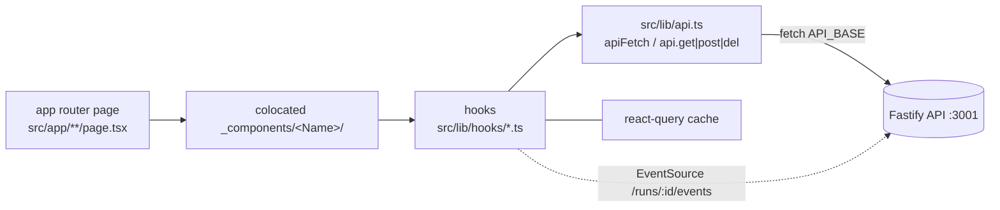

# Client architecture

Layering, top to bottom (route map and stack: [`../README.md`](../README.md)):

## Layers

- **Pages are thin.** Feature UI sits in `_components/<Name>/` next to the route, usually split into `<Name>.tsx`, `styles.ts`, `constants.ts`, `helpers.ts`, `index.ts` and a `*.test.tsx`. Example: `src/app/repos/[repoId]/pulls/[number]/_components/FindingsPanel/`.
- **All HTTP goes through `src/lib/api.ts`.** `API_BASE` = `NEXT_PUBLIC_API_BASE ?? http://localhost:3001` (`api.ts:5`). Failures are normalised to `ApiError` (`status`, `code`, `details`); a network failure becomes `status 0, code "network_error"`.
- **Hooks** are grouped by domain: `core.ts` (settings, repos, pulls, context files), `reviews.ts` (reviews, runs, finding actions, SSE), `agents.ts`, `trace.ts`, `repo-intel.ts`; re-exported from `hooks/index.ts`. Components never call `fetch` directly.
- **SSE** is the one non-react-query channel: `useRunEvents` (`hooks/reviews.ts`) opens an `EventSource` per run id and appends `RunEvent`s.

## Aliases to vendored code

`client/tsconfig.json` `paths`:

| Alias | Target | Note |
|---|---|---|
| `@/*` | `src/*` | |
| `@devdigest/shared` | `src/vendor/shared/index.ts` | Zod contracts (vendored copy; do not hand-edit — see root `CLAUDE.md`) |
| `@devdigest/ui` | `src/vendor/ui/index.ts` | primitives: `Badge`, `Icon`, `SEV`, `Toggle`, `EmptyState`, `CircularScore`, ... |

Use **`import type`** from `@devdigest/shared` — runtime value imports break the Next build (see [gotchas.md](gotchas.md)).

## react-query cache keys

Defined in `src/lib/hooks/*.ts`:

| Key | Hook | Endpoint | Invalidated / refreshed by |
|---|---|---|---|
| `["repos"]` | `useRepos` | `GET /repos` | add / refresh / delete repo (`core.ts`) |
| `["pulls", repoId]` | `usePulls` | `GET /repos/:id/pulls` | `useRefreshRepo`; auto-refetch every 60 s and on window focus (`core.ts:102-111`) |
| `["pull", prId]` | `usePullDetail` | `GET /pulls/:id` | — |
| `["reviews", prId]` | `usePrReviews` | `GET /pulls/:id/reviews` | `useRunReview`, `useFindingAction`, `useDeleteReview`, `useDeleteRun` |
| `["pr-runs", prId]` | `usePrRuns` | `GET /pulls/:id/runs` | `useDeleteRun`; page when a run settles; polls every 4 s while any run is `running` |
| `["pr-active-runs", prId]` | `usePrActiveRuns` | `GET /pulls/:id/runs/active` | page on run done; polls every 4 s while non-empty |
| `["pr-comments", prId]` | `usePrComments` | `GET /pulls/:id/comments` | `useCreatePrComment` |
| `["run-trace", runId]` | `useRunTrace` | `GET /runs/:id/trace` | — |
| `["agents"]`, `["agent", id]` | `agents.ts` | `/agents` | agent mutations |
| `["settings"]`, `["secrets-status"]`, `["provider-models", p]` | `core.ts` / `agents.ts` | `/settings`, ... | settings save |
| `["repo-intel-state", repoId]`, `["context", repoId]` | `repo-intel.ts` / `core.ts` | | resync / reindex |

Global defaults (`src/lib/providers.tsx`): `staleTime` 30 s, no refetch on window focus (individual hooks override, e.g. `usePulls`).

Rule of thumb: anything derived from a review (counters, verdict, timeline chips) is computed from `["reviews", prId]`, so **accept/dismiss -> invalidate `["reviews", prId]` -> everything recomputes**. Don't add a parallel cache. Note `useRunReview` / `useFindingAction` do **not** invalidate `["pulls", repoId]`, so list-level data reaches the PR list via its 60 s / focus refetch.

## i18n

- `next-intl`, **single locale `en`**, no locale routing (`src/i18n/request.ts`: `LOCALE = "en"`).
- `loadMessages` merges every `messages/en/<ns>.json` into `{ <ns>: {...} }` — adding a file adds a namespace, no registration needed. Namespaces include `prReview`, `runs`, `agents`, `settings`, `common`, `shell`, `onboarding`.
- Use `useTranslations("<ns>")` in client components. A missing key renders the raw key rather than throwing.
- Not everything is translated yet — several PR-page components (e.g. `FindingsTab`, `ReviewRunAccordion`) still hold literal English strings.
