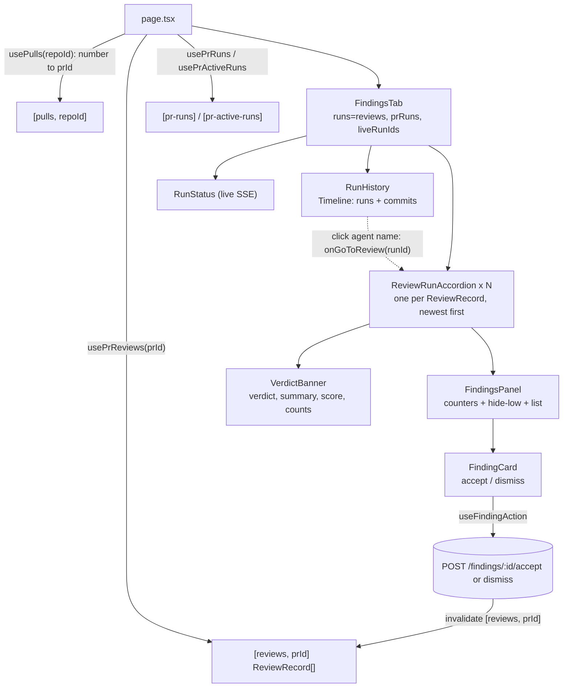

# PR review page — `/repos/[repoId]/pulls/[number]`

Root: `src/app/repos/[repoId]/pulls/[number]/page.tsx`. Tab state lives in the URL (`?tab=...`; `?trace=<runId>` opens the trace drawer).

## Data flow

Details:

1. The route is keyed by PR **number**, but every PR API by the row **uuid**: `page.tsx:36` resolves `prId` from the cached pulls list.
2. `usePrReviews` returns `ReviewRecord[]` **newest first** — one entry per agent run (a review row + its findings). `page.tsx:72-77` flattens them only for the page-level count and the "Lethal Trifecta" banner.
3. `FindingsTab` renders the live section, the **Timeline** (`RunHistory`: runs interleaved with commits, from `usePrRuns`), then **Review runs**: one `ReviewRunAccordion` per review. Clicking an agent in the timeline sets `{runId, nonce}`; the matching accordion opens and scrolls into view (`ReviewRunAccordion.tsx:47-53`). The first accordion is open by default.
4. Inside an accordion: `VerdictBanner` (only when `review.verdict` is set) then `FindingsPanel`. "Blockers" in the accordion header = non-dismissed CRITICAL findings (`ReviewRunAccordion.tsx:56`).
5. Timeline outcome colour comes from run-row `blockers` / `findings_count` (`RunHistory.tsx` `outcomeOf`), not from the model verdict.

## FindingsPanel (`_components/FindingsPanel/`)

- `visibleFindings(findings, hideLow, severity)` in `helpers.ts` is the single filter+sort used for both the list and the counters. Order: hide-low, then severity filter, then sort by `SEVERITY_ORDER` (`constants.ts`).
- **Hide low confidence** hides `confidence <= 0.7` (`LOW_CONFIDENCE_THRESHOLD`, `constants.ts:12`; filter `f.confidence > LOW_CONFIDENCE_THRESHOLD`, `helpers.ts:11`). A finding at exactly 0.7 is hidden.
- Severity counters (`countBySeverity`) are computed **after** hide-low, **before** the severity filter, so the numbers don't collapse when a level is selected. Spec: [`../specs/severity-counters.md`](../specs/severity-counters.md).
- Keyboard (`FindingsPanel.tsx:45-57`, window `keydown`, ignored in `INPUT`/`TEXTAREA`): `j` next, `k` previous (clamped to the visible list), `a` accept, `d` dismiss (`KEY_TO_ACTION`) on the focused card. Focus resets to 0 when a counter is clicked.
- `FindingCard` mutes accepted/dismissed cards (`accepted_at` / `dismissed_at`) and shows a tag; the server sets one and clears the other (`server/src/modules/reviews/repository/review.repo.ts` `setFindingAccepted` / `setFindingDismissed`).

## Tests

`FindingsPanel.test.tsx`, `FindingCard.test.tsx`, `VerdictBanner.test.tsx`, `RunHistory.test.tsx`, ... run under vitest + jsdom with `fetch` mocked (`pnpm test` in `client/`).
