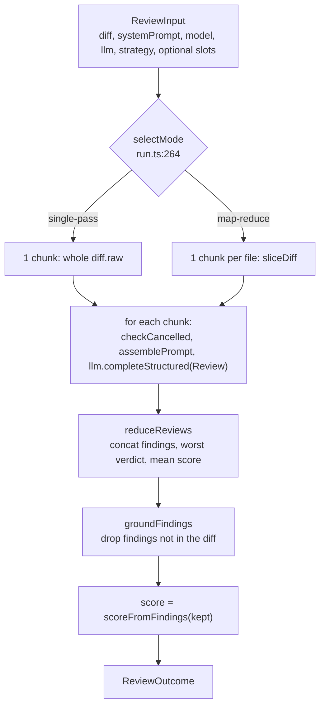

# Review pipeline

Entry point: `reviewPullRequest(input): Promise<ReviewOutcome>` in `src/review/run.ts:272`. High-level picture: [`../README.md`](../README.md).

## Steps

1. **Strategy** (`selectMode`): `single-pass` always one call; `map-reduce` one call per file (falls back to single-pass if only one file); `auto` (default) uses map-reduce only when total changed lines `> 400` (`DEFAULT_MAP_THRESHOLD_LINES`) **and** more than one file.
2. **Prompt** (`src/prompt.ts`, `assemblePrompt`): system = agent prompt + `INJECTION_GUARD`. User message sections in order, each omitted when empty: task line, `## PR description` (truncated to 4000 chars), `## Skills / rules`, `## Relevant memory`, `## Repo skeleton`, `## Project context` (specs), `## Callers of changed symbols`, `## Diff to review`. All untrusted content (diff, PR body, repo map, specs, callers) goes through `wrapUntrusted` (`<untrusted source="...">`, closing tags escaped). Skills/memory/specs arrive as already-resolved strings from the caller. The returned `assembly` is stored in the run trace.
3. **LLM call** per chunk: `llm.completeStructured<Review>({model, schema: Review, schemaName: 'Review', messages, maxRetries (default 2), sessionId})`. Tokens are summed; cost is summed and becomes `null` as soon as any chunk lacks a cost ([providers.md](providers.md)). Events (`info`/`tool`/`result`) go to `onEvent`; `checkCancelled` runs before each chunk and may throw.
4. **Structured output** (`src/llm/structured.ts`): `toJsonSchema` (Zod -> strict JSON Schema) and `parseWithRepair` (direct `JSON.parse`, fallback `extractJson` for fences/braces; on schema failure a reprompt message lists the issues and the provider retries).
5. **Reduce** (`src/review/reduce.ts`): one partial -> as is; several -> findings concatenated, worst verdict (`request_changes` > `comment` > `approve`), mean score, summaries joined with a space.
6. **Grounding** (`src/grounding.ts`, mandatory, once after reduce): see below.
7. **Score** is recomputed from the **surviving** findings: `100 - sum(penalty)` clamped to 0..100, penalties CRITICAL 35, WARNING 12, SUGGESTION 3 (`reduce.ts:381`). The model's own `score` is discarded. The model's `verdict` is **not** recomputed — it is the (reduced) model verdict.
8. **Outcome**: `{review, grounding, dropped, mode, assembly, chunks, tokensIn, tokensOut, costUsd, raw}`; fields in [`../specs/review-outcome.md`](../specs/review-outcome.md).

## Grounding gate

A finding is kept only if its file is in the diff and `[start_line, end_line]` **intersects** at least one new-side diff line (`buildLineIndex` uses hunk `newLineNumbers`, else the hunk's declared new range). Dropped findings carry a reason (`file '...' not present in diff` or `lines a-b do not intersect any diff hunk in '...'`) and each is emitted as an `info` event. Kinds `secret_leak`, `lethal_trifecta`, `phantom`, `hook` are full-file: they only need the file to be in the diff. `groundingSummary` renders `"kept/total passed"`.

## After the engine (outside this package)

- `countBlockers(findings, failOn)` / `gateTriggered` / `toReviewPayload` (`src/output/to-review.ts`) turn findings into the blocker count and a GitHub review payload. The review **event** is deterministic: no findings -> `APPROVE`; gate tripped -> `REQUEST_CHANGES`; else `COMMENT`. Gate thresholds by `ci_fail_on`: `never` (never trips), `critical`, `warning`, `any`.
- The server persists the outcome: [`../../server/docs/review-run-flow.md`](../../server/docs/review-run-flow.md).

## Tests

Hermetic vitest with a stubbed `LLMProvider` (`npm test` in `reviewer-core/`).
