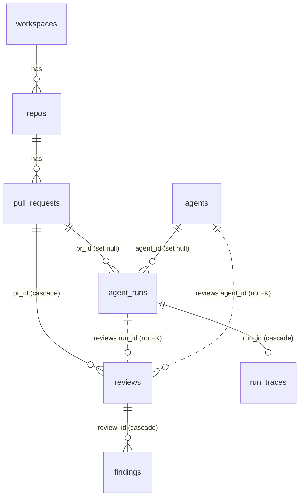

# Data model

Source: `src/db/schema/*.ts` (barrel `src/db/schema.ts`, Drizzle ORM, Postgres + pgvector). Only the tables the review flow touches are described; the schema contains more (eval, ci, knowledge, repo-intel, ...) that sit empty until later milestones — see [`../README.md`](../README.md).

Every domain table has `workspace_id` -> `workspaces.id` (cascade) except child tables reached through a parent (`findings`, `run_traces`, `pr_files`, `pr_commits`).

| Table | File | Key columns |
|---|---|---|
| `repos` | `schema/repos.ts` | `owner`, `name`, `full_name`, `default_branch`, `clone_path`, `last_polled_at`; unique `(workspace_id, full_name)` |
| `pull_requests` | `schema/pulls.ts` | `repo_id`, `number`, `title`, `author`, `branch`, `base`, `head_sha`, **`last_reviewed_sha`**, `additions/deletions/files_count`, `status` (GitHub merge state), `body`, `opened_at`, `updated_at`; unique `(repo_id, number)` (idempotent import) |
| `pr_files`, `pr_commits` | `schema/pulls.ts` | per-PR diff files (`patch`) and commits; cascade from the PR |
| `reviews` | `schema/reviews.ts` | `pr_id`, `agent_id`, **`run_id`** (links timeline run to review), `kind` (`summary`/`review`), `verdict`, `summary`, `score`, `model`, `created_at` |
| `findings` | `schema/reviews.ts` | `review_id`, `file`, `start_line`, `end_line`, `severity` (text: CRITICAL/WARNING/SUGGESTION), `category`, `title`, `rationale`, `suggestion`, `confidence` (double), `kind`, `trifecta_components`, `accepted_at`, `dismissed_at` |
| `agents` | `schema/agents.ts` | `name`, `provider` (`openai`/`anthropic`/`openrouter`), `model`, `system_prompt`, `strategy` (`single-pass`/`map-reduce`/`auto`), `ci_fail_on` (`never`/`critical`/`warning`/`any`), `repo_intel`, `enabled`, `version` |
| `agent_runs` | `schema/runs.ts` | `agent_id`, `pr_id`, `ran_at`, `provider`, `model`, `status` (`running`/`done`/`failed`/`cancelled`), `error`, `duration_ms`, `tokens_in/out`, `findings_count`, `grounding`, `score`, `blockers`, `source` (`local`/`ci`) |
| `run_traces` | `schema/runs.ts` | `run_id` (PK, FK), `trace` jsonb — whole run log as one document |

Things to know:

- `reviews.agent_id` / `reviews.run_id` have **no foreign keys** (plain uuid); `agent_runs.pr_id` / `agent_id` are `set null` on delete. Deleting a review cascades to its findings; deleting a run is handled in `run.repo.ts` (`deleteAgentRun`) and the client then invalidates both `["pr-runs"]` and `["reviews"]`.
- Severity and verdict are **plain text**, not DB enums; validity is enforced by the Zod contracts (`@devdigest/shared`).
- A PR can have many reviews (one per agent run). "Latest review" questions must say whether they mean newest overall (`score` on the PR list) or newest **per agent** (`findings_*`) — see [`../specs/pulls-list-api.md`](../specs/pulls-list-api.md).
- Accept and dismiss are mutually exclusive: each setter clears the other timestamp (`review.repo.ts`).

## Migrations

`drizzle.config.ts`: schema `src/db/schema.ts`, output `src/db/migrations/`. Edit the schema, run `pnpm db:generate` (drizzle-kit) to produce the SQL + `meta/` snapshot, apply with `pnpm db:migrate` (`src/db/migrate.ts`), seed with `pnpm db:seed`. **Never hand-write or edit files in `src/db/migrations/`** (root `CLAUDE.md` do-not-touch); new columns = your own generated migration only.
