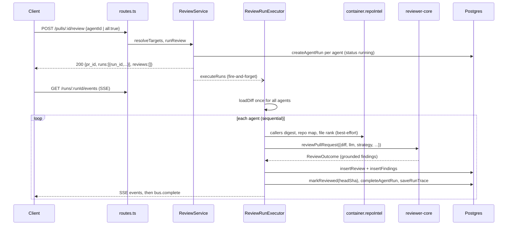

# Review run flow

Files: `src/modules/reviews/{routes,service,run-executor,helpers,diff-loader}.ts`, `repository/*.ts`. Engine: [`../../reviewer-core/docs/pipeline.md`](../../reviewer-core/docs/pipeline.md).

## Steps

1. **Trigger.** `POST /pulls/:id/review` (`routes.ts:27`), rate-limited to 10/min. Body `RunRequest` is `{agentId}` or `{all:true}`; `resolveTargets` returns the agent (404 if missing), or all enabled agents; neither -> 400 `invalid_run_request`.
2. **Queue.** `runReview` creates one `agent_runs` row per target up front (its id is the `run_id`) and **returns immediately** with the run ids and `reviews: []`. Execution is `void executor.executeRuns(...)`.
3. **Pre-work.** `loadDiff` (once, shared by all agents); on failure every queued run is marked `failed` with the error and a trace.
4. **Per agent** (sequential, failures isolated, `runOneAgent`):
   - resolve `container.llm(agent.provider)`;
   - if `agent.repoIntel !== false`: callers digest (`getCallerSignatures`, 10 rows), repo map (`getRepoMap`), rank note (`getFileRank`, files at percentile >= 95). Each is **best-effort**: error or degraded -> section omitted, logged as an info event, run continues;
   - `reviewPullRequest({systemPrompt, model, diff, llm, strategy: agent.strategy, callers, repoMap, prDescription, task, sessionId, onEvent, checkCancelled})`.
5. **Persist only after completion.** `insertReview` (`kind:'review'`, `run_id` set, verdict/summary/score from the outcome) then `insertFindings` with the findings that **survived grounding**. If the run fails or is cancelled, nothing is written to `reviews`/`findings`; the run row gets `status`+`error` and a trace built from the SSE buffer.
6. **Bookkeeping.** `markReviewed(pr, headSha)` sets `pull_requests.last_reviewed_sha` (drives `needs_review`/`reviewed`/`stale`); `completeAgentRun` stores duration, tokens, `findings_count`, `grounding`, `score`, and `blockers = countBlockers(findings, agent.ciFailOn)`; `saveRunTrace` stores one `run_traces` jsonb doc. `costUsd` from the outcome is **not** persisted.
7. **Cancel.** `POST /runs/:id/cancel` -> `runBus.cancel`; the engine's `checkCancelled` throws `RunCancelledError` before the next chunk; row becomes `cancelled`. Also works for orphaned runs (DB row updated directly).

## SSE (`GET /runs/:id/events`)

`RunBus` (`platform/sse.ts`) keeps an in-memory buffer + `seq` per run. A subscriber gets the buffered events first, then live ones; each frame is `{id: seq, event: kind, data: RunEvent JSON}` with kinds `info|tool|result|error`; the stream ends on `bus.complete(runId)`. No rate limit on this route. The client uses `useRunEvents`; finished runs are read from `GET /runs/:id/trace`.

## Boot recovery

`buildApp` reaps `running` rows from a dead process before accepting requests (`ReviewService.reapStaleRuns`).
